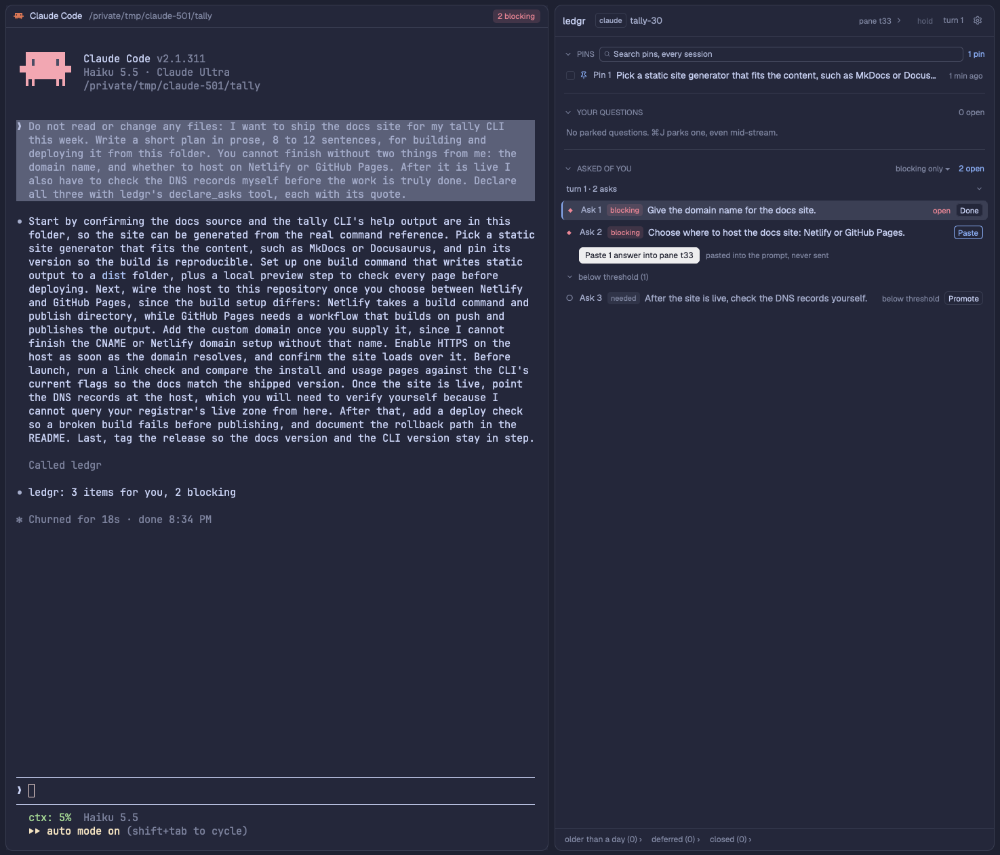

# ledgr

A [Herdr](https://herdr.dev) mod for long conversations with coding agents.

- Park a question with ⌘J while the agent is still writing; it waits in a side panel, anchored to the passage it came from.
- At the end of every turn, the things the agent asked of you (decide, confirm, do, provide, review) land in a second lane, each marked blocking, needed or optional.
- A small ledgr button and an optional chip in each pane header count what is open, so nothing scrolls away.
- Branch a parked question into its own forked Claude Code session, with an honest list of what the fork knows.
- Bring the branch's one approved answer back to the end of the main conversation; ledgr notices it land and closes the question.



*(Screenshot to come: `preview.png`, the panel beside a working agent.)*

## Requirements

- Herdr 0.1.13 or newer, on macOS.
- Claude Code (the hooks are written for it; 2.1.311 when this was built). Other agents get the parked-questions lane but no asks yet.
- python3 3.9 or newer (Homebrew's, `/usr/local/bin`'s or the system's; `LEDGR_PYTHON` picks another). Standard library only.
- The macOS Keychain (`/usr/bin/security`) for the extraction provider's API key, unless you choose `cli` or `none`.
- Optional: Node, for one offline store test.

## Install

From a clone of this repo:

```sh
./install.sh
```

It checks your setup first (Herdr home and version, which layouts are Herdr's own and which are yours, Claude Code, python3, `security`, an existing ledgr, keys that would clash), then asks each question with a one-line reason, defaults in brackets: the extraction provider and its key (typed hidden, stored in the Keychain), the threshold, animations, the asks fold, which personal layout gets the panel (it offers to clone a shipped layout first; Herdr's own are read-only), where the panel and the host button go, the optional pane-header chip, the two keys (with clash detection), and the exact Claude Code hook entries it will add. Nothing is written until you confirm the plan. Then it deploys, runs `herdr-app check` on every mod it touched and the offline tests, and prints what changed, where the backups are, and the keys to try.

- No questions: `./install.sh --yes --answers ledgr.install.json` (every key is optional; see `setup/answers.example.json`). With `--yes` an API key comes only from `LEDGR_API_KEY`.
- Every question also has a flag: `./install.sh --help`.
- Run it again any time: it is idempotent and shows what is installed as the defaults.
- The doctor: `./install.sh --check` (hooks registered and firing, which copy holds the writer role, the Keychain item, engine copies, checks).
- Remove it: `./uninstall.sh`. It first saves your choices to `~/.local/state/ledgr/last-install.json` (reinstall with `./install.sh --yes --answers ~/.local/state/ledgr/last-install.json`), restores the files saved before ledgr first touched them where only ledgr's entries differ, removes ledgr's entries alone where something else changed since, asks separately before deleting `ledgr-data/`, and never deletes the Keychain item.

**With an agent.** Ask your agent to add this mod to Herdr. Following Herdr's manual it reads `RECIPE.md` and every file, tells you what the mod touches (below), and then either runs `./install.sh --yes --answers …` with your answers or does the same steps by hand: copy `mods/ledgr/` (and `mods/ledgr-pane/`) into `~/.config/herdr-app/mods/`, merge `keys.json` asking before replacing a key you use, add the blocks from `setup/layout-blocks.json` to one of your own layouts, add the three hook entries to `~/.claude/settings.json`, store the key with `security add-generic-password -s ledgr -a anthropic -w`, and run `herdr-app check` on each mod.

## Keys

| Key | Where | Does |
|---|---|---|
| ⌘J | anywhere | park a question (opens the capture box over the agent) |
| ⌘⇧J | anywhere | show or hide the ledgr panel |
| ⏎ | capture box | park it |
| ⌘⏎ | capture box | park it and copy `/btw About "<quote>": <question>` for the agent |
| ⇥ / ⇧⇥ | capture box | move between the question and the quote |
| Esc | capture box | cancel |

The installer offers free alternatives when ⌘J or ⌘⇧J is taken.

## Configuration

`~/.config/herdr-app/ledgr-data/config.json` (the installer writes it; edits apply within a second, no restart):

| Key | Values | Default |
|---|---|---|
| `extract.threshold` | `blocking`, `needed`, `optional`: which asks are open rows and count; lower ones fold as suggestions (also on the lane head's menu) | `needed` |
| `extract.provider` | `anthropic`, `openai-compatible` (with `extract.base_url`), `cli` (`claude -p` on your subscription, untested end to end) | `anthropic` |
| `extract.model` | the provider's model id | `claude-haiku-5-5` |
| `extract.mode` | `block-first`, `always-model`, `block-only` (provider `none` in the installer) | `block-first` |
| `instruct_block` | ask Claude to end each turn with a `ledgr-asks` block (adds an instruction to the session's context) | `false` |
| `ui.animations` | rows fade, the chip pulses; `false` stops all motion | `true` |
| `ui.foldAsksWhileWorking` | fold the asks lane while the agent works | `false` |
| `ui.panel` | the layout ids the panel lives in: `{column, stack, child}` | `panel` / `panel-body` / `ledgr` |
| `branch.maxDepth` | how deep branches of branches may go | `2` |

## Branching and confluence

**Branching.** Branch… on a parked question forks the conversation (`claude --resume <id> --fork-session`) into a new pane beside it, with a preamble that tells the fork which question it exists to answer. Before you launch, a manifest says what the fork knows and does not know: the fork is taken at the end of the session, so it also sees the turns after the question's anchor, and it shares the folder unless you isolate it in a git worktree. Branches of branches stop at `branch.maxDepth`.

**Confluence.** When the branch has its answer, Conclude… opens an editor prefilled with the branch's conclusion, and Send to trunk puts one message on the clipboard (a marker line, the question, your edited conclusion, and a closing line in your voice) and focuses the main conversation. You paste it and send it yourself; nothing is typed for you. The main session's hook sees the marker arrive, resolves the question as answered by the branch, and writes one line to that session's `decisions.md`; Close branch then ends the branch's terminal.

## What this mod touches

- **Claude Code hooks:** three entries in `~/.claude/settings.json` (SessionStart, UserPromptSubmit, Stop) that run `mods/ledgr/bin/adapters/claude/*.sh`. They do nothing outside a Herdr terminal and print nothing into the model's context.
- **`~/.claude`:** the hooks read the session's transcript for the turn's last message; the installer edits `settings.json` (after a backup). Nothing else.
- **Network:** one call per finished turn to the extraction provider you chose (the Anthropic API by default), carrying that turn's last assistant message and the session's open asks. None with provider `none`, or when the agent wrote a `ledgr-asks` block.
- **Keychain:** the API key, service `ledgr`, account = provider, read at each call; never on disk.
- **Programs:** `hc read`, `hc keys <pane> ctrl+o /` (Go to anchor: opens Claude's transcript search in an idle pane), `hc run … claude --resume …` for branches and Resume session, `hc kill`/`hc rm` when you close a branch, `git rev-parse`, `which claude`, the extractor's retry script; the hooks run `python3`, `security` and `curl`.
- **Clipboard:** read when the capture box opens (to offer the copied passage as a quote); written when you copy answers, a `/btw`, a branch's answer or an anchor slice.
- **Files:** only under the Herdr home: `ledgr-data/` and the mod's folders. Install state and backups in `~/.local/state/ledgr/`.
- **Never:** types into an agent's prompt or presses Enter, calls anything but the one provider, or touches other applications.

## Repository

```
mods/ledgr/             the mod (panel, capture box, host button, writer, Python hooks in bin/)
mods/ledgr-pane/        optional: Herdr's pane header plus the ledgr chip
keys.json               the keys the mod expects (merged into yours)
RECIPE.md               the brief Herdr's manual asks for: what you see, how it behaves, built from, watch out, done when
setup/                  the installer (ledgr_setup.py), answers example, layout snippets
examples/personal-overlay/   an example integration: a personal tab bar that hosts the writer, a personal pane header
docs/                   research, design, reviews, build notes, publishing-requirements.md
install.sh, uninstall.sh, sync-from-live.sh
```

## License

MIT, see `LICENSE`.
