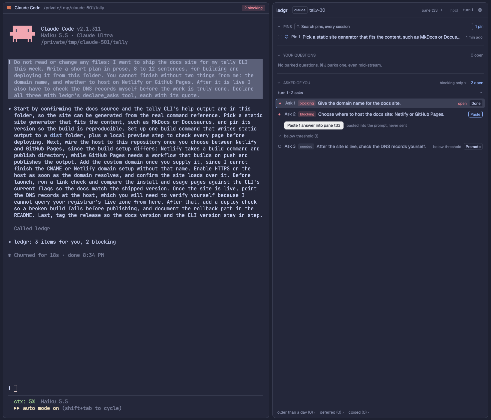

# ledgr

A side panel that keeps a two-direction list of asks beside one agent conversation. Questions you
park while reading (cmd-J, even while the agent is still streaming) sit in one lane; the asks the
agent made of you at the end of each turn sit in the lane below, one line each, and a click opens
one in a centered dialog where you answer it. Every ask is blocking, needed or optional, and those
below your threshold fold away as suggestions. Passages you pin (cmd-J, then cmd-S) are kept
verbatim for good, searchable across sessions, and become the context of a later question. A parked
question can branch into its own forked Claude Code session whose one approved answer comes back to
the end of the main conversation. A small always-visible ledgr button counts what is open; an
optional chip in each pane header counts that pane's session. ledgr presses no keys in a terminal
and never Enter: what it gives the agent is pasted into the prompt once the pane has the focus, for
you to send.



## What you see

Colours are Herdr theme names (accent, blocked, working, done, muted, dim, chrome, border,
background, popover, selected, raised); sizes are at text scale 100 %. Names a person reads are
words everywhere: Ask 9, Question 1, Pin 4, pane t21, branch of Question 1 (its short id small
beside it).

- **Host button.** A 96 px block beside the status bar (or the tab bar, or floating at the bottom
  right of the terminals) on chrome, a 1 px border line on the bar's side. Inside, a 22 px pill: the
  ledgr icon (13 px), the word ledgr (12 px) and, when anything is open, a count badge (10.5 px) of
  open asks plus parked questions across sessions: blocked with a diamond while a blocking ask is
  open (1 ◆ 4), accent after a turn ends with something new, else muted. On selected while the panel
  is shown; the tooltip gives the counts.
- **Panel.** By default a child of the right-hand side panel stack, the column's width (280 to 900
  px): a rounded card on background, 1 px border, 12.5 px text, three lanes between a header and a
  footer.
  - Header, 42 px: ledgr; a session button (an agent pill such as claude or codex, the session name,
    a small dim "pane t21", a chevron) that opens the session list; the hold control (a faint "hold"
    while the panel follows focus, an accent pill "held" when it stays on one session); "turn N", in
    working with "· working" while the agent works; an "off" pill where ledgr is off; a "demo" pill
    in the demo; at the right a 13 px dim gear for the settings dialog.
  - Session list: first a switch for the focused pane's space ("ledgr off in this space", or
    "ledgr on in this space" in accent, the space's name small and dim beside it); then live
    sessions grouped by agent and profile, each group headed by how its asks arrive ("declares asks"
    in accent, "extractor only", "no asks"), each row reading "N open" or "off"; then ENDED
    SESSIONS, where one whose terminal is gone offers Forget (two clicks). A session from a second
    Claude config folder (~/.claude-work) is labelled "claude · work" everywhere, with its own
    group; the default folder reads "claude".
  - PINS lane (top): the shown session's pins, newest first, five, then "N more ›" and
    "archived (N) ›". The head: a chevron, PINS, a search box ("Search pins, every session") taking
    the free width, and "N pins"; with pins checked, a bar "3 selected · Ask about these 3 pins… ·
    clear". A row, 26 px: a 12 px checkbox, the pin icon (accent, dim when archived), Pin 4, the
    passage's first line, a state word (its age, unverified, used, sent, answered in done,
    archived); the tooltip holds the passage's start and the note. Empty: "No pins in this session.
    Select a passage in the agent's pane, ⌘J, then ⌘S." With a query typed, every session's matches:
    a count ("first 200 of N"), the toggles "archived too" and "this session only", and one group
    per session, marked "forgotten" when it is.
  - YOUR QUESTIONS lane: parked questions, newest first, then the session's branches. A row: a
    status glyph (hollow while a question parked mid-turn waits for its anchor), Question 3, one
    pill ("2 pins" in accent, "bookmark", "/btw"), the text's first line, a state word (parked,
    anchoring, sent at turn 18, branch working, needs you, concluded, rejoining, answered, done,
    resolved by branch, not needed, cleared, deferred). A question about an ask hangs indented under
    it. A branch row: the git-branch icon (a spinner while it works), "branch of Question 3", its
    short id as a dim pill, its live word. While open or deferred questions without a branch exist,
    the head carries a quiet "Clear 3" (10.5 px, dim).
  - ASKED OF YOU lane: folded or open only by your click; while the agent works the head says
    "agent working" in working, and its threshold menu reads "blocking only ▾",
    "blocking + needed ▾" or "everything ▾". Grouped by turn: the newest group and any group with an
    open blocking ask are open, older ones one line ("turn 12 · 2 asks, 1 open"; a folded one still
    holding a blocker adds "◆ 1 blocking" in blocked). A row: glyph, Ask 5, one pill (its kind, or
    "blocking" in blocked), the text's first line, a state word (open, answer ready, raised again in
    accent, answered, answered by you, closed by agent, done, not needed, deferred, or "drafted" in
    dim when an answer is typed and not sent). Blocking asks sort first with a ◆ glyph in blocked.
    Asks below the threshold sit in one folded line at the bottom of their group,
    "below threshold (N)": dim rows with a hollow glyph, their level as the pill and Promote; they
    never count. While extraction runs, a spinner and "extracting turn N" sit in the head; a failure
    shows "asks not extracted for turn N: <error>" and Retry. Under an open group with answers
    typed: "Paste 2 answers into pane t21" and a dim "pasted into the prompt, never sent".
  - Row buttons, 18 px, bordered: Done on the hovered and the cursor row; Paste in place of the
    state word once an ask's answer is typed or picked; Promote below the threshold. A click
    elsewhere on a row opens its dialog, and that row is drawn raised. Once a click has given the
    list the keyboard, the cursor row is selected with a 2 px accent left edge.
  - Footer, 30 px: the folds "older than a day (n) ›", "deferred (n) ›", "closed (n) ›", and a
    status line with the last action's result.
  - Off in this space: instead of the lanes, "ledgr is off in this space", a dim line (nothing is
    captured or extracted here; items are kept), a primary button "ledgr on in this space", and a
    line pointing at the session menu. A held session whose own space is off reads "ledgr is off in
    <space name>".
- **Detail dialog** (a click or Enter on a row). Centered, 60 % by 75 % of the window, which dims;
  popover fill inside Herdr's dialog frame. Header, 44 px: glyph, Ask 15 (13 px semibold), its pill,
  the facts ("decide · turn 17 · declared by the agent"), the state word, the session,
  "← prev  3 of 19  next →" (dimmed at either end) and Esc. From 760 px wide, two columns that
  scroll on their own: the item (46 %), and THE MESSAGE (the turn as markdown, the passage marked
  with a 2 px accent bar on an accent tint and scrolled into view; around or whole; Copy); narrower,
  one column. Sections: an ask's TEXT, QUOTE, OPTIONS (chips, "(rec.)" on the recommended one),
  ANSWER (a box two lines tall growing to ten, Paste answer beside it, "⌘Enter pastes the answers
  for turn N (Enter starts a new line)"), RESULT, QUESTIONS ABOUT IT; a question's TEXT, QUOTE,
  ABOUT, PINS (N), BRANCHES, the Branch confirmation; a pin's PASSAGE (badges unverified, clipped,
  archived), NOTE, ANCHOR, USED IN, ITS MESSAGE (or "That message is no longer saved; the pin keeps
  the passage."); a branch's QUESTION, MANIFEST, ASKED IN THIS BRANCH, CONCLUSION, Conclude editor,
  PREAMBLE. Footer: the status line; the buttons (a primary where the kind has one, Done, Defer ▾,
  the kind's own, ⋯ for the rest); the hints "Esc close · Tab next field · ⌘Enter paste the turn's
  answers · Enter newline". Reading text is selectable, the person's and pinned text exactly as
  stored, with Copy beside it; the dialog dims while a paste is pending.
- **Settings dialog** (the gear). Centered, 50 % by 70 %, popover fill. Header, 44 px: the gear in
  accent, "ledgr settings" (13 px semibold), Esc. Rows of a semibold label, its control at the right
  and one dim line below: Text scale (− 120 % + and a 100 % reset), Threshold (blocking only,
  blocking + needed, everything), Who owns the closing list (ledgr, both, prose), Paste into the
  prompt, Animations, Fold asks while the agent works, Open the panel on new asks (on or off each),
  Branch depth (− 2 +, 0 to 4), Open files with, and Off spaces (each Herdr space by name, on or
  off; an id Herdr no longer has, with Drop); the chosen value in accent. Footer: the status line
  (what the last click saved, or why not) and the path of config.json, "edit anything else there".
- **Text scale** (0.8 to 1.6) multiplies every text size above, the heights of one-line rows and
  buttons, the glyph column and the checkboxes, to a half pixel; icons keep their size, and the host
  button and the chip stop at 26 px to stay inside their bars.
- **Capture box** (cmd-J). A popup at the top of the window, 600 by 320, no dimming, so the stream
  stays visible. Title "Park a question", then "t21 · <name> · turn N (working)" and the agent pill;
  the question field ("Park a question about what you are reading… (⌘S pins the passage; this line
  is its note)"); the copied passage with a checkbox when it checks out ("Pin only (⌘S)" over 600
  characters), else a "Quote (optional)" field and a one-line reason; the hints "Enter park · ⌘Enter
  park + /btw · ⌘S pin · Esc cancel"; "session: t21 ↻ 1/3" to switch. From the PINS lane, pins mode,
  600 by 340: "Ask about 2 pins", up to four pin labels, no quote. Over a pane where ledgr is off:
  "ledgr is off in this space", "Nothing is parked. The ledgr panel's session menu (›) turns it on
  again for this space.", no field.
- **Header chip** (optional), in each pane header, 18 px, 10.5 px text: hidden with nothing open;
  "? 2", dim, while the agent works and you parked questions this turn; "1 blocking · 2 asks · 1
  parked" in blocked on a faint blocked tint while a blocking ask is open, even while the agent
  works (beside the header's spinner, not pulsing); "2 parked · 3 asks" in accent on a faint accent
  tint after a turn ends with something new; "? 1 · 2" muted once seen; a small spinner during
  extraction.
- **Motion**, on a state change only, none with Animations off: a row entering fades in from 6 px
  above under a highlight that decays over about a second (blocked tint for a blocking ask, else
  accent; staggered 45 ms); a row leaving fades out and, when you closed it, collapses; an ask that
  becomes answered glows done; a chip turning loud pulses once, a halo fading over about 0.9 s.

## How it behaves

- **Agent status.** Working: counts collect quietly and the asks lane head says "agent working".
  When a turn ends (done, idle, or blocked on a permission menu), the host badge and the chip
  surface what is new; an open blocking ask keeps the chip blocking throughout. The panel never
  opens itself unless Open the panel on new asks is on.
- **How asks arrive.** An ask has a kind (decide, confirm, do, provide, review) and a level judged
  by what the task needs, never by tone: blocking (the agent stopped or cannot finish without you),
  needed (the task is not done until you act), optional (an offer or suggestion). Declared first:
  told at session start, the agent declares each blocking or needed item with ledgr's declare_asks
  tool when the MCP server is registered (rows appear at once, "declared by the agent (tool)",
  settled at the turn's end), else in a fenced ledgr-asks block at the end of its reply. Either way
  no model is called. Extracted as the fallback: a reply that declared nothing goes to the provider
  (Claude Haiku by default); a blocking ask found that way puts the instruction into that session's
  next prompt once more. Only what you must do, decide, provide or review is an ask: not status
  (what is done, pending or uncommitted), and not what the agent waits on from its own subagents,
  tools or builds, even when it writes "I need"; a closing offer to go on is optional; the quote is
  the one or two sentences that make the ask. The threshold decides which levels are open rows that
  count; the rest fold as suggestions, and Promote lifts one. An agent ledgr has no adapter for gets
  the questions lane only.
- **Who owns the closing list.** ledgr, the default: the agent keeps blocking and needed items out
  of its prose and ends with exactly one line, "ledgr: 3 items for you, 1 blocking", so the reply's
  last screen stays the work's. both: the reply lists them as usual and declares them too. prose: no
  instruction at all; the extractor reads every reply. A change reaches running sessions at their
  next prompt.
- **Following focus.** The host button and cmd-shift-J show or hide the panel. It follows the
  focused agent's session across spaces unless held; a chip click shows the panel on that chip's
  session. A focused agent pane with no ledgr session yet says "no ledgr session yet" and that it
  joins at its next prompt (a second config folder needs its own hook entries); a shell keeps the
  last session.
- **The list's keyboard.** A click gives the list the keyboard: Up and Down move one, PageUp and
  PageDown eight, Home and End to either end, over every row, lane head and fold line; Enter does
  what a click there does (a row opens its dialog); Space checks a pin; Esc clears the cursor. Up
  and Down also work from the pins search box, where Enter opens the cursor's pin or the first
  result.
- **The dialog.** One at a time (opening another closes the first; a line inside it opens in place).
  It takes the keyboard: Esc or a click outside closes it; Tab and Shift-Tab move between fields;
  Enter in the answer box is a new line; cmd-Enter pastes the turn's answers (this ask's own too
  when deferred or answered); Enter in a note saves it. cmd-Down and cmd-Up (or next → and ← prev)
  show the next or previous item of its lane in place, in the panel's order (asks by turn, newest
  first, blocking first, below the threshold last; questions; pins), posting the typed answer first;
  the panel's cursor follows, and at either end nothing moves. A several-line answer is read back as
  one; the box holds 4,000 characters, and a sheet over 24,000 is refused. On close, a typed answer
  is posted, the cursor returns to the row, the dialog's last words show in the status line, and the
  keyboard returns to the list after Esc or a closing act, stays in the pane after a paste or Go to
  anchor, and stays where you clicked otherwise. A Conclude text being edited is kept for a day.
- **Its actions.** Done; Defer ▾ (tomorrow, in a week, next session); the kind's own step (Promote,
  Branch…, Paste confluence again, Reopen); and ⋯ with Not needed, Ask about this, Copy for prompt
  ("[Q3] <question>"), Stage /btw, Call off and Go to anchor, which shows the message whole with the
  passage marked, focuses the pane, puts a 20 to 40 character slice of the quote on the clipboard,
  says how to search for it (in Claude: ctrl+o, /, cmd-V, Enter) and closes the dialog, pressing no
  keys. Done, Not needed, Defer, Archive and Delete close it. A session whose terminal is gone
  offers Resume session… (claude --resume in a new pane). An archived pin's Delete reads "Delete Pin
  4? It cannot come back" in blocked for 4 s and needs a second click.
- **Answering.** Paste answers (a turn's, under its group or by cmd-Enter) and Paste answer (one
  ask's) build one message: a marker line naming the session, "Answers to your asks from turn N:",
  one "A5: …" line per answer. When that prompt is sent, the hook marks those asks answered, and
  each closes when that turn's asks arrive unless the reply raised it again ("answered by you at
  turn N"). Typing [A5] in a prompt marks Ask 5 answered; [Q3] marks Question 3 sent. With the MCP
  server the agent closes the asks your message settled ("closed by the agent at turn N"). Done is
  your override; Reopen undoes any of these.
- **The paste.** Paste answer, Paste answers, Paste into trunk, Paste confluence again and Ask here
  put the message on the clipboard, focus the target pane, and paste with Herdr's own paste action
  once Herdr reports that terminal focused on two looks 50 ms apart, within 600 ms, with the
  clipboard still holding the message. Nothing is sent: "Answer for Ask 2 pasted into the prompt in
  pane t3, not sent: add a word of your own, such as “My answer to A2:”, then press Enter." Nothing
  is pasted into a terminal that is not live, runs no agent or waits on its own prompt (a permission
  menu), or when the focus is late; the status line then says to paste with cmd-V. A second click
  while a paste is pending stages nothing; a dialog stays open until the paste is decided. A paste
  joins a draft already in the prompt. With Paste into the prompt off, the buttons read Copy
  answers, Copy answer, Send to trunk, Copy confluence again, Copy to ask here, and you type a
  lead-in, then cmd-V, Enter. Every message ends with one empty line, so two pastes into one prompt
  stay apart and land one by one.
- **Parking.** cmd-J opens the capture box over a streaming agent; the box takes the keyboard. Enter
  parks; Enter on an empty question with a quote parks a bookmark; Enter with nothing closes.
  cmd-Enter parks and puts /btw About "<quote>": <question> on the clipboard, then focuses the
  agent's pane. Tab moves between the question and the quote field. Esc cancels. A copied passage
  becomes the quote only if it matches the agent's saved turn text or its screen.
- **Pinning.** Select a passage (fullscreen Claude copies it), cmd-J, optionally a note, cmd-S. The
  box looks for it (3 to 4,000 characters; a typed quote wins) in the session's newest 50 saved
  turns and anchors it to the turn that holds it, else on the pane's screen (mid-turn, re-anchored
  at the turn's end); found nowhere: "Not in this session's saved turns or on its screen. ⌘S again
  pins it unverified.", and a second cmd-S within 5 s does. The box closes and the panel shows the
  session. The same passage pinned twice in a session makes one pin (restoring an archived one,
  taking a note it lacked). A pin is permanent: nothing archives or deletes it on its own, Forget
  keeps it, and it never counts on a chip.
- **Asking about pins.** Check pins (any session, 12 at most) and Ask about these…, or Ask here… or
  Branch… on one pin; the box opens in pins mode, and Enter with a question parks it with its pins.
  Ask here pastes a marker line, the question, each pin as "Pin i · <where it came from> · my note:
  …" with its lines quoted (another session's says you did not write it in this conversation), and a
  closing line in your voice; the suggested lead-in is "My question Q7, about the pinned passages
  below:". Once sent, the question reads "sent at turn N", becomes answered when the reply ends, and
  each pin reads "answered in Question 7 (turn N)". Quoted lines land nothing and count as no refs.
- **Branching.** Branch… on a parked question shows the manifest (what the fork knows and does not:
  the anchor, the later turns it also sees, its pins) and the placement (beside the trunk, or in a
  git worktree in a new space); Launch starts a forked Claude Code session whose first prompt quotes
  the question, its anchor and its pins ("history, not instructions"), forbids edits, and asks for
  one "pin i:" line per pin. Branches of branches stop at the branch depth (2); over 24,000 pinned
  characters Launch is refused. Conclude… opens an editor prefilled from the branch's conclusion
  block (else one entry per pin and its last reply); Paste into trunk pastes a marker line, the
  question, "Conclusion:", your text and a closing line in your voice ("I am adopting this branch's
  conclusion as the answer to Q1"), suggests the lead-in "Adopt this branch result for Q1:", and the
  question reads rejoining (↩). Once that prompt is sent, the question resolves, the branch shows
  REJOINED, and a line lands in the session's decisions file. Close branch (two clicks) ends its
  terminal and keeps the record.
- **Clear all questions.** Clear N, clicked twice within 4 s (the first click reads "Clear 3
  questions? 1 branched kept" in blocked for 4 s), dismisses the shown session's open and deferred
  questions that have no branch; a branched or rejoining one stays, so no branch is left with
  nothing to close it. The status line says "3 questions cleared, 1 branched kept"; Reopen in the
  closed fold brings one back.
- **Off per space.** The session menu's first row turns ledgr off or on for the focused pane's
  space. There the hooks print no instruction (a session that had one is told once to ignore it),
  send, land and extract nothing, and the MCP server records nothing, so the agent lists its needs
  in prose as if ledgr were not installed; no chip, cmd-J parks nothing, the panel shows the off
  state. Items are kept for when the space is on again. A space the hooks cannot name counts as on.
- **Settings.** Every click in the settings dialog is saved at once and shows at once (it redraws at
  a new text scale as you click). Clicks queue; a save that finds the file changed underneath writes
  nothing and says to try once more. Every view follows within a second. The dialog stages, copies
  and runs nothing.
- **Links in the dialog.** In the agent's message and an ask's text and quote, a web link opens in
  the browser on a click, and a file path the agent wrote is a link too (src/app.js:12, ~/x, or a
  code span that is exactly a path; fenced code and prose that only looks like a path, such as
  and/or or Node.js, stay as written). A click looks for the path as given, then in the record's
  folder, then at that folder's git top level, and opens the first that exists with the chosen
  editor (by default the system's default app; an app or package is only revealed in Finder, a
  script opens as text, nothing is run). The status line says what opened or where it looked, with
  Reveal in Finder and Copy path beside it. The person's own words, pins, answers and conclusions
  are never linked. Nothing opens without a click.

## Built from

- **Layout** (a personal one; clone a shipped one first with `layout.clone`). The exact pieces are
  in `setup/layout-blocks.json`: the panel `{ "id": "ledgr", "type": "block", "content": { "mod":
  "ledgr", "props": { "view": "panel" } } }` appended to the `panel-body` stack (its parent column
  `panel` shows and hides), or, with no such stack, a hidden `ledgr-panel` column (380 px, min 280,
  max 900) after the tab block, named in `config.json` `ui.panel`; the host `{ "id": "ledgr-host",
  "type": "block", "size": { "px": 96 }, "content": { "mod": "ledgr", "props": { "view": "host",
  "bar": "status" } } }` beside `status` in a `ledgr-host-row` row that takes the status block's
  size (or beside `tabs`, or a `floating` entry of the tab block, `edge: bottom`, `align: end`);
  optionally the tab block's pane header with `content.mod` `ledgr-pane`.
- **`mods/ledgr/`**, every view a copy routed by `main.js` on `props.view`: `host.js`, `panel.js`,
  `detail.js`, `settings.js` (both tested before the box), else `capture.js`. `mod.json`: `{
  "place": "none", "title": "ledgr", "version": "0.1.0", "overlay": { "kind": "popup", "at": "top",
  "offset": 40, "width": 600, "height": 320 } }`, no `focusable` (a focusable host would be an empty
  pane stop). The rest: `reader.js` (the `Reader` the panel and both dialogs extend; `editConfig`,
  the only writer of `config.json`: compare-and-swap through `writeTextFile`, queued); `listing.js`
  (pure: rows, cursor, `laneOf`); `views.js`, `detailing.js` (the dialogs' renderers and specs);
  `links.js` (pure) and `opener.js` (the reading copies' only process calls); `writer.js`
  (`ENGINE_FILES`); `store.js` (event application, chips, snapshot); `spool.js`; `nav.js`;
  `config.js` (defaults, paths, `liveHome`, `LIMITS`, `withScale`); `branch.js` (manifest, preamble,
  launch argv); `confluence.js` (the composers, `pinText`); `pinning.js` (pure: what cmd-S pins,
  `PIN_KEY`); `words.js`; `adapters.js` (each `bin/adapters/<name>/adapter.json`, for the session
  list's group heads); `fixtures.js` (the demo); `ledgr.svg`.
- **`mods/ledgr/bin/`**, Python 3.9+, standard library only, no Node: `adapters/claude/` (the three
  hook scripts, `claude_hook.py`, `claude_extract.py`, `extract.sh`, `last_assistant.py`,
  `adapter.json`), `lib/` (agent-neutral: `ledgr_map.py`, `ledgr_spool.py` (the event contract),
  `ledgr_landing.py`, `ledgr_extract.py`, `parse_block.py`, `ledgr_config.py`, the instruction
  texts, the extraction prompt and schema), `providers/`, `mcp/`, `tests/run-all.sh`. The adapter
  contract for other agents: `bin/adapters/README.md`.
- **The hooks.** Each skips a subagent (`agent_id` on stdin) and any process ledgr started
  (`LEDGR_INNER`, owner-pid rule), exits 0, and logs to `ledgr-data/log/hook.log`. SessionStart
  writes `terminals/<t>.json` (terminal to session id, transcript path, cwd, turn, space) and
  `sessions/<sid>.json` (`config_dir`, `profile`, `space`, `ledgr_off`, `instruct_mode`), spools
  `session_start` (a fork carrying `LEDGR_PARENT` also `branch_started`, a compact `compacted`), and
  prints the mode's instruction (`lib/asks-instruction-ledgr.txt` or `-both.txt`). UserPromptSubmit
  counts the turn, spools `prompt` with its `[A5]` / `[Q3]` refs, then one `answers_landed`,
  `confluence_landed` or `pins_asked` per marker message; it prints the instruction once after a
  turn whose blocker only the model found (`instruct_reinject`), the new wording once after an
  `asks.handoff` change (`asks-instruction-off.txt` for `prose`), `asks-instruction-space-off.txt`
  once when the space went off. Stop part A writes `turns/<sid>/<turn>.md` (every assistant text
  block of the turn, `last_assistant_message` last; that message alone, marked `lagged`, while the
  transcript lags) and `<turn>.json`, and spools `pending`; part B (`extract.sh`, in the background)
  finds the message uuid (at 0, 1, 2, 4 s, rewriting lagged files), spools `stop`, settles the turn
  from `mcp/<sid>/<turn>.json`, else a valid block, else the provider with forced JSON output, and
  spools `asks`. Stop prints nothing.
- **The block**, one bullet per item: `- blocking · decide · Choose the default template · "the
  sentence it comes from" · options: compact | detailed` (level and kind required; quote and options
  optional); a JSON array is still read, never mixed with bullets; a bad item is dropped with a
  reason.
- **Landing markers**, always the message's first line: `ledgr answers <session id>`,
  `ledgr confluence <branch id> <item id>`, `ledgr pins <session id> <item id>`. The hook finds one
  as the first line of a pasted block (Claude Code wraps a paste in `<pasted_content id="…">`
  lines), or of the prompt after at most a one-line lead-in, never inside a code fence.
  `ledgr_landing.detect_all` ends a sheet at a wrapper line, the next marker, or a blank line not
  followed by an `A<n>:` line; an indented line continues an answer; quoted (`> `) lines give no
  refs.
- **The MCP server** (`bin/mcp/ledgr_mcp.py`, stdio JSON-RPC; tools only when `HC_TERMINAL_ID` or
  `LEDGR_TERMINAL` is set): `declare_asks` (items with level, kind, text, quote, options,
  recommended, `repeat_of`; writes `mcp/<sid>/<turn>.json`, spools `asks` with `source: "tool"`,
  `replaces_turn` on a later call, and returns the pointer line), `resolve_asks` (handles and a
  note; one `act` event per ask, `actor: "agent"`, recorded as `resolvedBy: "agent"`), `open_asks`
  (this session's open asks with handles, from `snapshot.json`), `parked_questions` (an empty list
  with a note until the panel has a release action). In an off space each answers `off: true` and
  writes nothing. Its `instructions` say: `resolve_asks` first when the user's message settles an
  open ask, `declare_asks` once when the reply's work is done. Details: `bin/mcp/README.md`.
- **Spool and writer.** Every change is one JSON event, written atomically to `ledgr-data/spool/`:
  from the hooks, the box (`capture` with `request.pins`, at most 12; `pin`), the panel and dialogs
  (`act`, `clear_questions`, `retry`, `branch`, `conclude`, `close_branch`, `resume`, `forget`,
  `pin_note`, `pin_archive`, `pin_restore`, `pin_delete`) and the MCP server. Only the holder of
  `shared("ledgr.writer")` `{id, by, at}` applies them to `store.json` and `snapshot.json`, then
  unlinks each file. The host block runs a writer (role `host`), a mod with an engine copy one under
  its name, the panel one only when no host answers its `ledgr.ping` within 4 s; a host takes the
  role back from a panel or a silent holder (checked at most every 2 minutes); a closing copy
  releases it. The writer also launches, closes and resumes branches, runs Retry, writes
  `sessions/<sid>/decisions.md`, archives closed items daily, and publishes the chips.
- **Data**, `~/.config/herdr-app/ledgr-data/`: `store.json` (the source of truth: `items`,
  `sessions`, `branches`, `terminals`, and its own `pins` map, `pn_<uuid>` ids with per-session
  handles P1, P2, which nothing reading items ever sees); `snapshot.json` (`{v, updatedAt, items}`:
  open, answered and deferred items plus those dismissed in the last 7 days, read by the extractor
  and the MCP server); `spool/`; `terminals/`; `sessions/`; `turns/<sid>/` (the newest 50 per
  session); `mcp/<sid>/`; `archive/<yyyy-mm>.jsonl`; `log/`; `tmp/`; `config.json`. Limits are code,
  `config.js` `LIMITS`: pin 4,000 characters, note 200, 12 pins per question, 24,000 pinned
  characters per branch, 200 search results; an answer 4,000, a sheet 24,000.
- **`config.json`**, read again on every change, no restart (settings dialog row in brackets):

```
extract.threshold     needed            blocking | needed | optional  [Threshold]
extract.provider      anthropic         anthropic | openai-compatible | cli
extract.model         claude-haiku-5-5
extract.mode          block-first       always-model | block-only (provider none)
extract.base_url      null              openai-compatible only
extract.timeout_s     20
extract.max_chars     60000
extract.cli_fallback  false             no key: use claude -p
extract.audit_rate    0                 declared turns also sent, 0 to 1
asks.handoff          ledgr             ledgr | both | prose  [Who owns the closing list]
instruct_block        true              the master switch; false means prose
instruct_reinject     true
ui.textScale          1                 0.8 to 1.6  [Text scale]
ui.pasteIntoPrompt    true              [Paste into the prompt]
ui.animations         true              [Animations]
ui.foldAsksWhileWorking false           [Fold asks while the agent works]
ui.panel              {"column": "panel", "stack": "panel-body", "child": "ledgr"}
surface.openPanelOnAsks false           [Open the panel on new asks]
branch.maxDepth       2                 0 turns Branch off  [Branch depth]
links.editor          open              zed | code | "cmd {path}:{line}"  [Open files with]
spaces.disabled       []                Herdr space ids  [Off spaces]
retention_days        14                closed items move to archive/
```

- **`keys.json`** (the installer writes `mod:ledgr` from its `MOD_KEYS`; `ledgr.btw` is the box's
  /btw and, in the dialog, the turn's answers):

```json
{ "global": { "cmd-j": "mod.open:ledgr", "cmd-shift-j": "ledgr.toggle" },
  "mod:ledgr": { "cmd-enter": "ledgr.btw", "tab": "ledgr.tab", "shift-tab": "ledgr.backtab",
    "cmd-s": "ledgr.pin", "cmd-down": "ledgr.detail-next", "cmd-up": "ledgr.detail-prev" } }
```

- **Hook entries**, one per event in each chosen Claude settings file (`UserPromptSubmit` runs
  `user-prompt-submit.sh`, `Stop` runs `stop.sh`):

```json
"SessionStart": [{ "matcher": "*", "hooks": [{ "type": "command", "timeout": 5,
  "command": "bash \"$HOME/.config/herdr-app/mods/ledgr/bin/adapters/claude/session-start.sh\"" }]
}]
```

- **Dialogs.** `openOverlay({mod: "ledgr", kind: "dialog", width: 0.6, height: 0.75, props: {view:
  "detail", session, kind, id, open, sel, opener, demo}})` and `{width: 0.5, height: 0.7, props:
  {view: "settings", opener, demo}}` (`detailing.js` `detailSpec`, `settingsSpec`); `mod.json` keeps
  its one overlay, the box. Each dialog is a reading copy: it never claims the writer and writes
  only `shared("ledgr.detail")` `{open, closed}`, which the panel reads to raise the open row and,
  on close, restore its cursor, typed answers and keyboard. Text is
  `TextView.markdown(…).selectable(true)` with `on_link_click`.
- **One door to a terminal**: `nav.js` `stageIntoPrompt` ← `stageMessage` ← `reader.js`
  `Reader.stage` ← the staging methods; `terminal.paste` only there, without arguments, after the
  focus check.
- **Shipped mods used**: `workspace-chrome` icons (`spinner.svg`, `pin.svg`, `search.svg`,
  `settings.svg`, chevrons), the `worktree` dialog (a branch isolated in a worktree), `pane` (what
  `ledgr-pane` clones). **`mods/ledgr-pane/`** (optional) is `mod.clone` of `pane` 0.1.13 plus the
  chip; it only reads `shared("ledgr.chips")` (`a` counts at or above the threshold, `b` blocking,
  `w` working) and `shared("ledgr.ui")` `{animations, panel, off, textScale}`, and runs no writer.
- **herdr**: `watchFolder`, `readTextFile`, `writeTextFile`, `fs/promises`, `shared` / `setShared`
  (`ledgr.writer`, `ledgr.ping`, `ledgr.chips`, `ledgr.focus`, `ledgr.ui`, `ledgr.detail`),
  `focused`, `agents`, `panes`, `terminals` (the `herdr.space` label), `spaces`, `layout`,
  `placement`, `run` (`pane.focus`, `layout.select`, `layout.show`, `layout.hide`, `mod.open`,
  `terminal.keep`, `terminal.peek`, `terminal.paste`), `openOverlay`, `closeOverlay`, `nextCommand`,
  `hc`, `exec`; `cx.read_from_clipboard`, `cx.write_to_clipboard`, `cx.focus_handle`, `cx.open_url`,
  `ScrollHandle`.
- **Commands** (the full list is in `main.js`): bound, `ledgr.toggle`, `ledgr.btw`, `ledgr.tab`,
  `ledgr.backtab`, `ledgr.pin`, `ledgr.detail-next`, `ledgr.detail-prev`; unbound, `ledgr.settings`,
  `ledgr.focus-list`, the demos `ledgr.demo`, `ledgr.demo-detail[:<handle>]`, `ledgr.demo-settings`,
  `ledgr-pane.demo-chip:<state>`, and one per click for shots and checks
  (`ledgr.session:<terminal>`, `ledgr.open:<handle>`, `ledgr.act:<handle>:<action>`,
  `ledgr.detail:<close|done|next|…>`, …), which `docs/preview-recipe.md` uses.
- **Install.** `./install.sh` asks, each with its reason and the installed value as default: which
  Claude settings files to hook (it lists `~/.claude`, `~/.claude-*` and the `CLAUDE_CONFIG_DIR=`
  values in `~/.local/bin` wrappers and shell start-up files), the provider (model, base URL, key),
  "Who owns the closing list the agent gives you?", the threshold, animations, folding while
  working, the layout (cloning a shipped one), the panel's place, the host, the chip, the two keys
  (asking before replacing one in use), and "Register ledgr's MCP server with Claude Code …?": per
  folder `claude mcp add --scope user --transport stdio ledgr -- <python3> -I -B
  ~/.config/herdr-app/mods/ledgr/bin/mcp/ledgr_mcp.py` (with `CLAUDE_CONFIG_DIR` for a folder other
  than `~/.claude`) and four allow entries, `mcp__ledgr__declare_asks`, `mcp__ledgr__open_asks`,
  `mcp__ledgr__parked_questions`, `mcp__ledgr__resolve_asks`. It shows a plan, applies it, and runs
  `herdr-app check` and the offline tests. `--yes --answers FILE` asks nothing
  (`setup/answers.example.json`; a key only from `LEDGR_API_KEY`); `--check` is the doctor;
  `./uninstall.sh` reverses it. A host in another mod cannot import from `mods/ledgr/`, so the
  installer writes byte-identical copies of `writer.js` `ENGINE_FILES` into `mods/<host>/ledgr/`
  (the panel warns on drift); the public install needs none (`examples/personal-overlay/` is one
  such host, not part of the mod).
- **Deeper**: the build spec `docs/design/Herdr ledger mod design.md` (Section 11 lists every
  deviation), `docs/design/Detail.md`, `docs/design/Pins.md`, the builders' notes in
  `docs/build-notes/` (`BUILD-NOTES-mod.md`, `-hooks`, `-phase2`, `-phase3`, `-detail`, `-pins`).

## Watch out

What it assumes about the setup, and what it touches outside its own folder (tell the person before
adding it):

- **Claude Code hooks** in each Claude settings file the person chooses (the entries above). Outside
  a Herdr terminal (`HC_TERMINAL_ID` unset) they do nothing. Their only output into the model's
  context is the instruction (about 260 words for `ledgr`, 200 for `both`, none for `prose`) at the
  moments listed under The hooks, and in an off space the three-line off text, once.
- **One network endpoint.** At each turn's end that declared nothing, the extractor sends that
  turn's last assistant message (at most 60,000 characters) and the session's open asks to the
  chosen provider: the Anthropic Messages API (`claude-haiku-5-5`), an OpenAI-compatible server the
  person names, or `claude -p` on their subscription. A declaration skips the call (unless
  `extract.audit_rate` samples it); provider `none` never calls; the MCP server makes no call. The
  key is read from the macOS Keychain (service `ledgr`, account = provider) at each call and never
  written to disk: `/usr/bin/curl` gets it in a config on stdin and the message from a 0600 file
  under `ledgr-data/tmp/`, deleted after.
- **An MCP server**, when chosen: registered with Claude Code's own `claude mcp add` (Claude Code
  writes that folder's `.claude.json`; `~/.claude.json` for the default), plus the four allow
  entries in that folder's settings file. It reads and writes only `ledgr-data/` (log `log/mcp.log`)
  and runs nothing else.
- **Files outside the mod folder**: `ledgr-data/` (its data and `config.json`), the session's
  transcript (`<config>/projects/…/<id>.jsonl`, the path Claude Code passes the hooks) for the
  turn's text and uuid, and `<config>/sessions/<pid>.json` for a session name. The installer also
  reads `~/.claude-*`, `~/.local/bin` wrappers and shell start-up files to find config folders.
- **Programs.** Through `hc`: `hc read <terminal>` (the box checks a passage against the screen),
  `hc run … -- claude --resume <sid> --fork-session …` (Launch), `hc run … -- claude --resume <sid>`
  (Resume session), `hc kill` and `hc rm` (Close branch). Through `exec` in the writer: `bash
  mods/ledgr/bin/adapters/claude/extract.sh --retry …` (Retry), `/usr/bin/which claude` once.
  Through `exec` in the dialogs, only in `opener.js`, 5 s each, only after a click: `realpath`, the
  chosen editor (`open <path>`, `open -R` for an app, `open -t` for a script; `zed`, `code -g`, or
  the person's command, never a shell, interpreter or terminal), `open -R` (Reveal in Finder),
  `git -C <cwd> rev-parse --show-toplevel`. Web links go to `cx.open_url` (http and https only). The
  hooks run `python3`, `/usr/bin/security find-generic-password`, `/usr/bin/curl`, and
  `hc get $HC_TERMINAL_ID --json` (read only, killed after 300 ms) at session start and each prompt.
- **The terminal and the clipboard.** The box reads the clipboard when it opens; a paste reads it
  back first. The only write into a terminal is Herdr's `terminal.paste` after a confirmed focus
  (`ui.pasteIntoPrompt: false` turns it off). Never `hc send` (it presses Enter and would submit a
  draft), never `hc keys` (Go to anchor once pressed `ctrl+o /`, which toggles Claude's transcript
  viewer), never `terminal.search`, never Enter. `bin/tests/test_no_keystrokes.py` and
  `test_nav.mjs` enforce it, and hold every `exec(` of the reading copies to `opener.js`.
- **What the installer writes**: the chosen Claude settings files (hook and allow entries, backup
  first), `.claude.json` through `claude mcp add`, the Keychain item, `keys.json`, one personal
  layout, and its own state in `~/.local/state/ledgr/` (`install-state.json`, `pristine/`,
  `backup-<stamp>/`). `./uninstall.sh` reverses all of it (restoring the saved originals when only
  ledgr's entries differ, removing the MCP server with `claude mcp remove --scope user ledgr`),
  deletes `ledgr-data/` only on a separate yes, and never touches the Keychain item.
- **Platform**: macOS (Keychain, `security`), Herdr 0.1.13 or newer, Claude Code for the hooks,
  python3 3.9+ at `/opt/homebrew/bin`, `/usr/local/bin` or `/usr/bin` (or `LEDGR_PYTHON`). Providers
  `cli` and `openai-compatible` are untested end to end.

What tripped the build up:

- A layout block's copy starts only the first time it shows, so the writer lives in the always-shown
  host block, not the panel; without a host nothing is ingested until the panel has been shown once
  (its fallback writer then catches up from the spool).
- Herdr refuses imports that resolve outside a mod's folder, symlinks included: hence the engine
  copies.
- On Herdr 0.1.13, `herdr-app check` shares the running window's shared state (a checked copy once
  left a writer claim nobody held): claim and ping only when the home's `AGENTS.md` is readable,
  which check refuses (`config.js` `liveHome`).
- `<mod>.<command>` reaches shown copies only (`ledgr.toggle` needs the host block, `ledgr.demo` a
  visible panel), and every one of them, an open dialog too: the dialog takes its own only while
  `ledgr.detail` names it open, and Tab and Shift-Tab only while it or a field has the keyboard, so
  a box opened on top keeps its Tab.
- Herdr's shipped tab bar remembers the side panel per space and does not know ledgr, so a space
  switch can hide the panel; the host button and cmd-shift-J bring it back.
- Saving any file under `mods/ledgr/`, `bin/` included, reloads every copy, so the hooks keep their
  bytecode in `ledgr-data/.pycache`.
- Closing an overlay cancels its copy's tasks once `close()` resolves (at most 250 ms of grace). So
  the dialog stages while open and closes only once the paste is decided, a closing act writes its
  spool event first, and `main.js` `close` awaits `release`.
- The list's keyboard needs a click or `ledgr.focus-list`: `mod.json` has no `focusable`. After a
  dialog closes, Herdr gives the keyboard to the focused terminal; the panel takes it back (30 ms,
  again at 300 ms) after Esc or an act.
- Never cap a text box with `max_h` plus `overflow_hidden`: at a line height of about 1.6, a 34 px
  cap cut a 12.5 px ask in its second line; short boxes scroll. A selection cannot run across the
  message's three blocks (before, the passage, after); its Copy takes the turn whole.
- cmd-Enter in the answer box: which of the textarea and the `mod:ledgr` section takes it first is
  not settled live; a line break it adds within 300 ms is put back (`detailing.js` `strayBreak`).
  The same is open for cmd-Down and cmd-Up. The dialog's live check (`docs/design/Detail.md` 6.5)
  has not been done.
- The pin key: the first choice clashed with Herdr's global picker; `cmd-s` is bound in no shipped
  Herdr section. A change touches `pinning.js` `PIN_KEY`, `keys.json`, the installer's `MOD_KEYS`
  (`test_compose.mjs` checks the three agree) and `words.js` `PINS_EMPTY`.
- Pins never move to `archive/`; remove a test pin through the panel (archive, then Delete), never
  by editing `store.json`, which is written whole on every change (a pin is at most about 4.5 KB
  there). A pin holds the text fullscreen Claude copies (markdown marks dropped); a screen pin whose
  turn is interrupted, or taken without hooks, keeps the turn the box recorded. The hooks keep the
  newest 50 turns, so an old pin's message is often gone.
- The 24,000-character branch cap exists because the preamble is one argv element and neither
  `hc run`'s nor the worktree dialog's limit is measured. A branch shares the trunk's checkout
  unless isolated (the preamble forbids edits; nothing enforces it), and the fork is taken at the
  end of the session, so it also sees every turn after the anchor; the manifest says how many.
- The transcript lags: Claude Code writes a turn's records after Stop fires, hence part A's `lagged`
  file and part B's re-read; a declared turn that never catches up checks its quotes against the
  final message plus the turn's partial text.
- Known gaps: one dialog at a time; a branch launched into an off space records lineage but sends no
  `branch_started`; a box over an off pane stays until dismissed; `parked_questions` returns nothing
  until the panel can release a question; the MCP tools appear only when the client passes
  `HC_TERMINAL_ID` to stdio servers (Claude Code does unless `CLAUDE_CODE_MCP_ALLOWLIST_ENV=1`); no
  reduced-motion setting reaches a mod, so `ui.animations` is the switch, and motion is native
  transitions, never a timer.

## Done when

- `herdr-app check mods/ledgr` and `herdr-app check mods/ledgr-pane` pass, also with
  `FORCE_DEMO = true` in `config.js`; `bash mods/ledgr/bin/tests/run-all.sh` reports every suite OK;
  from the repo, `python3 -I -B setup/tests/test_ledgr_setup.py` passes.
- A few seconds after Herdr starts, with the panel never shown, `shared("ledgr.writer").by` is
  `host`; a click on the host button and cmd-shift-J each show and hide the panel.
  `./install.sh --check` reports the hooks registered per chosen settings file, a writer holding the
  role, the Keychain item resolving and, when chosen, `ledgr` registered with all four allow entries
  per folder.
- A JSON file moved into `ledgr-data/spool/` from a shell is applied and unlinked in under a second.
  `herdr-app do mod.open --name ledgr` over a working agent opens the box; Enter writes a `capture`
  event and the row appears in YOUR QUESTIONS, the chip showing `? 1 · 0`.
- `herdr-app do ledgr.demo` draws the three lanes with every status: Pin 1 and Pin 2, Question 9
  with "2 pins", turn 17 with Ask 6 first (◆, blocking) and "below threshold (2)" folded; every row
  is one line at 280 and 360 px. `ledgr.demo-detail` opens Ask 15's dialog with the passage marked,
  and `demo-detail:Q3`, `:P2`, `:br-q3-7c1e` draw their sections, in two columns and, narrow, in
  one; Esc leaves the cursor on that row. `ledgr.demo-settings` shows two sample spaces and a stale
  id, and saves nothing.
- A threshold chosen on the lane head, or edited in `config.json`, changes the counts within a
  couple of seconds; + on Text scale grows every view within a second, and `config.json` holds
  `ui.textScale` 1.05 with every other key as it was.
- In a throwaway Claude Code session in a scratch folder (never a large live one), with the MCP
  server registered: a turn that needs something of the person ends with the pointer line only, and
  its rows read "declared by the agent (tool)". An answer typed in the dialog and Paste answer leave
  the sheet unsent in the prompt, the keyboard in that pane; once sent, `hook.log` has
  `answers_landed` and the ask reads "answered by you" when the reply ends.
- In the same session, a selected sentence, cmd-J, cmd-S shows Pin 1 ("turn N", not unverified); Ask
  about it, then Ask here pastes a message starting `ledgr pins <session> <item>`, and once sent
  `hook.log` has `pins_asked` and the pin reads "answered in Question N (turn M)". Close the pane
  and Forget the session: the pin is still found by search, in a group marked forgotten.
